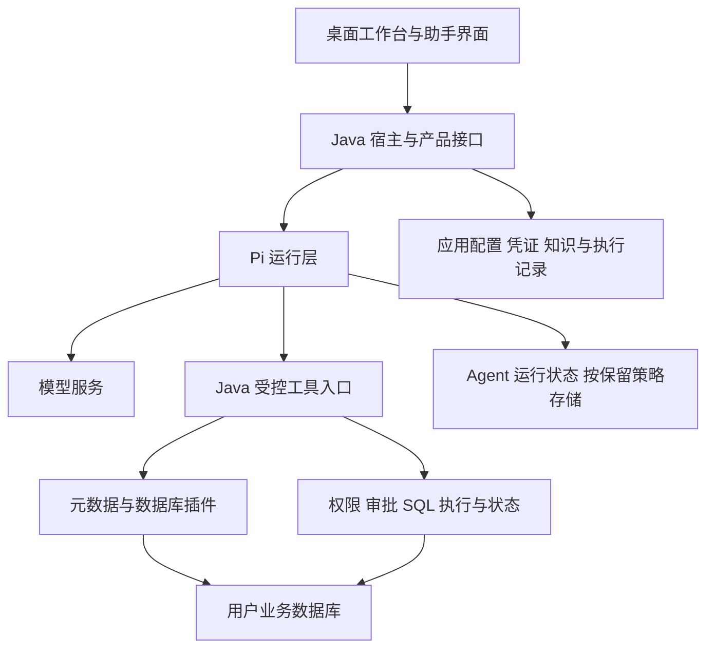

# 桌面产品与 Pi 迁移规划调整

日期：2026-11-06。

2026-11-26 更新：将同仓库主工作树中的规划纳入本分支。第 2 节保留规划形成时的基线；本轮实现、验证与选型状态见 [A/B 交付记录](PI-STAGES-AB-2026-11-26.md)。当前依赖已升级到 Core / pi-ai 1.5.0，Durable 已有原型与宿主恢复验证。
依据：本次讨论、`feature/desktop-pi` 工作区代码和既有实施记录。
状态：阶段 A 正在收口；阶段 B 本轮选择继续 Core 1.5.0，保留 Durable 原型和复评条件。阶段 C 已接入 SQL、选区、文档版本与用户明确选择的错误/结果引用，见 [上下文实施记录](CHAT-CONTEXT-REFERENCES.md)。存储格式、桌面外壳和发布支持矩阵继续按相应阶段验证。

参考版本更新：截至 2026-11-06，官方最新已发布版本为 **Pi v1.5.0（2026-11-02 发布）**。本规划的新原型与接口设计参考 v1.5.0；规划形成时项目依赖为 1.4.0，现已单独升级到 1.5.0，升级与回归记录见 A/B 交付记录。以已发布版本标签和对应包文档为依据，不直接把 `main` 或浮动 `latest` 用作可复现基线。

## 1. 产品目标与独立决策

先交付一个可靠的桌面数据库助手，以 Pi 为目标 Agent 引擎，复用 Java 数据库能力；存储与团队能力按产品需求独立推进。

首发面向数据库开发者，延续 DM8 优先和 MySQL 兼容回归的定位。本地单人、无需账号登录，安装后配置模型和数据源即可使用。首条核心用户任务为：

> 找到相关表 → 理解字段与必要业务口径 → 执行只读查询 → 检查结果 → 给出有依据的回答。

SQL 生成、选区解释和错误解释围绕工作台任务完善。macOS 与 Windows 分别提供验收证据，本机开发运行不等于双平台安装交付。

以下决策分别记录，不互为前提：

| 决策 | 当前方向 | 不由它推导的结论 |
| --- | --- | --- |
| 首发产品 | 桌面单人工作台 | 不代表后续不能建设团队版 |
| Agent 运行框架 | 以 Pi 为迁移目标，通过评测逐步切换 | 不要求取消账号、团队或数据库存储 |
| 部署依赖 | 无需用户额外部署应用 PostgreSQL | 不排除有明确需求时使用随包本地 SQLite |
| 会话策略 | 当前默认临时会话，不归档完整聊天 | 不等同于配置、知识、执行记录全部不保存 |

团队版暂缓。当前保持工作空间、连接归属和工具访问边界清楚，不提前建设多人平台，也不恢复旧 server 模式。未来团队版需另行设计身份、组织权限、共享资源和并发访问。

## 2. 规划形成时的基线与证据

本节区分当前代码事实、历史验证记录和待办，不将文档更新视为功能完成。

| 项目 | 当前事实或已有记录 | 仍需处理 |
| --- | --- | --- |
| 本地工作台 | 本地免登录入口、配置与凭证、工作台和内存助手已有实现；见 VC-01～VC-06 | 双平台、安装与真实环境验收，剩余旧代码裁剪 |
| Pi 依赖 | `Data-Agent-Pi-Worker/package.json` 固定 `pi-agent-core@1.4.0` 与 `pi-ai@1.4.0` | Core / Durable 选择；当前未接入 Coding Agent SDK 或 Durable |
| Pi 只读链路 | 数据源发现、范围发现、元数据、受限查询和流式输出已有实现 | 固定任务集整体评测与发布范围确认 |
| Explorer | 主 Pi 可委派独立 Pi Worker；Java 管理任务、预算、取消与结果校验；当前顺序执行 | 是否有相对单 Agent 的实际收益 |
| 会话与进程 | Pi 上下文由 Worker 内存持有，Java 管理进程与工具执行 | 不具备持久化任务恢复；不能把重建 Worker 当作恢复旧任务 |
| 功能差异 | Java 本地助手已有压缩和单次写入审批；Pi 路径尚未对齐 | 按阶段接入并分别验收，不能声称整套 main Agent 已完成等价迁移 |
| 引擎选择 | 当前工作区有 auto / Java / Pi 偏好；auto 在 Pi READY 时选择 Pi，新会话按偏好确定引擎 | 此界面路由不等于生产迁移验收通过；同一会话不切换引擎重放 |

证据入口：

- [Pi 依赖](../Data-Agent-Pi-Worker/package.json)、[Pi 内存会话](../Data-Agent-Pi-Worker/src/session.js)。
- [本地 Java 助手](../Data-Agent-Server/data-agent-server-app/src/main/java/edu/zsc/ai/local/LocalAssistantService.java)、[Pi 宿主](../Data-Agent-Server/data-agent-server-app/src/main/java/edu/zsc/ai/local/LocalPiChatService.java)、[Pi Explorer](../Data-Agent-Server/data-agent-server-app/src/main/java/edu/zsc/ai/local/LocalPiExplorer.java)。
- [PI-M1](PI-M1-IMPLEMENTATION-2026-10-30.md)、[PI-M2](PI-M2-READONLY-QUERY-2026-11-04.md)、[PI-M3](PI-M3-EXPLORER-2026-11-04.md)、[数据源发现](PI-DISCOVERY-2026-11-04.md)。各报告结果只代表当次环境和范围，本次未重新运行其测试。

## 3. 目标架构与迁移边界

| 层次 | 目标责任 |
| --- | --- |
| 桌面外壳 | 安装、窗口、运行时分发、进程启动退出、应用目录与升级 |
| 前端 | SQL 工作现场、输入与引用、结果、任务进度、审批交互 |
| Pi 运行层 | 模型交互、推理循环、上下文和任务委派；具体上层机制取决于 Core / Durable 决策 |
| Java 宿主与业务服务 | 模型配置与凭证来源、运行身份、连接管理、工具校验、预算、数据库执行、审批与执行事实 |
| 数据库插件 | 方言、对象身份、真实元数据、类型与 JDBC 能力 |

模型配置与凭证继续复用现有正式来源。Worker 使用按运行提供的配置与凭证，不另建一套模型管理产品。数据库凭证与实际连接留在 Java 受控边界。

当前 Explorer 仍由 Java 编排。框架选择后再确定是否将部分任务生命周期交给 Pi；迁移前必须明确唯一状态来源，避免 Java 与 Pi 同时推进同一个任务。Java 始终校验最终数据库操作。

Java Agent 在过渡期用于对照与回退，不长期扩建两套完整生产 Agent。Pi 达到约定范围的验收门槛后切换主入口，再清理闲置编排代码；保留 JDBC、插件和业务服务。回退作用于后续新会话，不在失败运行中换引擎重放。

优先整理已有输入、工具与事件契约。只抽取实际需要的接口，不提前搭建通用多 Agent 平台。解释与生成等有界任务无需强制经过完整 Agent 循环。

## 4. Core / Durable 的前置验证

在继续自建复杂会话压缩、恢复和任务队列之前，进行一次有边界的 Durable 验证。复用当前 Core 作为基线，验证分支或原型不算新增正式生产引擎。

| 验证问题 | 需要的证据 |
| --- | --- |
| 能否复用 Java 工具 | 完成同一只读任务，保留范围、连接版本、取消和结果限制 |
| 能否复用产品事件 | 文本、工具、子任务、失败和唯一终态在现有界面正确展示 |
| 是否满足会话策略 | 列出实际保存的消息、参数、结果与任务状态；验证关闭和清理行为 |
| 恢复是否符合产品语义 | 重启后确认哪些任务恢复、哪些中断；不重放未经确认的写入 |
| 是否适合桌面分发 | 锁定包与运行时版本，在目标环境验证启动、退出与存储 |
| 是否减少维护负担 | 对比需保留、自建和删除的代码及测试，记录接口变动成本 |

决策出口：

- 若近期只需要前台临时对话，Core 可以继续承担主链路，并明确自建能力范围。
- 若明确需要后台任务、重启恢复、长时间等待审批，优先评估 Durable 承接相应机制。
- 若结果不足以支持迁移，记录继续 Core 的原因和复评触发条件；不能将“完成调研”写成“已采用 Durable”。

Durable 官方在 v1.5.0 仍标记为实验性。它提供持久化、任务恢复、压缩和存储机制，但不自动提供本产品的团队权限、业务知识维护或数据库写入幂等。采用前按实际锁定版本核实 API。

### 4.1 版本验证顺序

1. 保留现有 Core / pi-ai 1.4.0 的任务与协议结果，作为改动前基线。
2. 单独验证 Core / pi-ai 1.5.0 升级，固定依赖和 lockfile，复测现有 Worker 与 Java 工具链。记录升级造成的行为变化，不同时切换运行框架。
3. 再以匹配的 Durable / pi-ai 1.5.0 和其声明的依赖构建原型，与 Core 1.5.0 在相同任务条件下对比。框架收益不能混入 1.4 → 1.5 的版本变化。
4. 结果通过后决定正式升级、框架选择与迁移范围。当前不因文档采用新参考而自动变更运行依赖或历史报告。

后续开始实施时再次检查官方发布；如采用更新版本，先补版本差异并重新锁定基线，不在验收中途静默追随最新版。

### 4.2 v1.5.0 的重点适配项

| 变化 | 项目验证与设计要求 |
| --- | --- |
| Core / pi-ai 工具校验转向 `pi-schema` | 常见 TypeBox JSON Schema 可以继续使用，但校验器、参数转换和错误文本已变化。验证缺失字段、非法类型、额外字段、边界数值和枚举；Java 最终校验继续保留，不只验证正常工具调用 |
| 流式工具参数改为增量解析 | 验证长参数、分块、取消与终态；不将上游性能改进直接等同于本项目端到端延迟改善 |
| Durable 移除旧 `watchEvents()`，改为会话状态视图订阅 | 原型按 `Conversation.watch()` 等新接口设计，再映射为产品自己的展示与事件契约；不直接照搬旧版事件桥。连接重建后验证视图恢复、结果去重与唯一终态 |
| Durable 存储接口支持批量提交，SQLite 适配接口变化 | 优先使用随版本提供的存储实现；若自定义后端，按新接口和一致性测试验证，不能复用旧 `Storage.commit()` 签名后假定兼容 |
| Durable 流式进度可延后落盘 | v1.5.0 默认 `progress.persistWithinMs` 为 1000 ms；区分已展示进度和已持久化状态，验证崩溃窗口与恢复结果，不能承诺每个可见增量都已保存 |
| Durable 中断请求与任务重启处理变化 | 模型请求中断按重试策略处理；验证重试预算与终态，避免恢复时无限重启或盲目重发写操作 |

这些是接入与回归要求，不是要求首发启用所有新功能。上游 Coding Agent 的终端界面、更新器等改进也不会因升级 Core 自动出现在 Data-Agent 中。

## 5. 数据保留与存储策略

将“去数据库化”改为“无需外部应用数据库服务，并逐类明确数据保留”。存储介质由查询、事务、恢复和可维护需求决定。

| 数据 | 近期策略 | 变更条件与边界 |
| --- | --- | --- |
| 用户业务数据 | 通过 Java 插件访问现有数据库 | 不属于应用存储迁移，不因换框架移动或删除 |
| 连接、模型与用途配置 | 复用现有本地配置 | 保留跨重启能力，不在 Pi 再维护一份 |
| 数据库密码、API Key | 专门凭证组件 | 不进入普通配置、前端、命令行或内容日志 |
| 临时对话 | 当前默认内存 | 不承诺关闭或崩溃后恢复上下文 |
| 业务知识与对象笔记 | 优先文件，按工作空间与对象范围管理 | 来源、确认状态、修改和删除可追踪；不直接保存整段聊天充当知识 |
| Skills | 文件化方法与模板，按需加载 | 与事实知识分开，不因加载技能扩大工具权限 |
| 审批与执行记录 | 独立设计最小保留范围，重点处理未决执行状态 | 持久化格式、保留期和升级迁移尚未确定 |
| 可恢复 Agent 任务 | 当前未启用，按真实需求决策 | 启用前确定内容范围、保留周期、清理和恢复语义 |

SQLite 可以作为无需用户另装服务的本地存储候选，不作为当前必须新增的依赖。PostgreSQL 等远程应用存储在团队需求成立后另行评估。Durable 的可扩展存储接口不等于任意数据库可以零适配接入。

“不归档完整聊天”和“恢复足够的任务状态”需要分别定义。恢复可能要求保存模型上下文、工具参数或结果；启用前更新产品说明与数据策略，不能同时承诺完全不保存这些内容和完整任务恢复。

任务日志也不自动保证业务写入只执行一次。审批绑定不可变请求，写入结果为 UNKNOWN 时先核对数据库事实，不自动重试；去重、恢复与执行记录需共同设计。

## 6. 后续交付顺序与验收

以下 A～F 是从当前实现继续推进的顺序，替代旧 S0～S6 的后续排期；旧编号继续用于历史任务与证据追溯，不重做已完成工作。

| 阶段 | 交付内容 | 验收出口 |
| --- | --- | --- |
| A：只读任务收口 | 发现数据源、理解对象、查询、回答、取消与失败处理 | 固定任务可重复完成，结果有来源，目标一致，终态唯一，截断与失败如实呈现 |
| B：运行框架选择 | Core 基线与 Durable 小范围原型 | 完成第 4 节验证，形成选择、暂缓项和复评条件 |
| C：工作上下文 | SQL、选区、文档版本、错误、对象与结果引用 | 切换文档或连接后不使用过期上下文，用户无需反复复制工作现场 |
| D：可安装版本 | 外壳、Java / Node、驱动、目录、进程与升级 | 在明确支持的干净目标机器上安装、启动、连接、查询与退出 |
| E：受控写入 | Pi 接入已有写入能力，完成预览、审批、执行与验证 | 审批与实际执行一致，重复请求、取消、断连、重启和 UNKNOWN 有明确行为 |
| F：知识与必要协作 | 文件知识管理、按效果扩展子代理；团队需求另行立项 | 新会话可用已确认知识，修改删除生效；协作收益有任务评测支持 |

最小上下文身份和工具范围是 A 的前提，复用已有能力；C 完善更丰富的编辑现场。必要业务口径可先显式提供，不要求 A 等待完整长期知识系统。已有对象笔记和 Skills 工作继续复用，不因排期调整丢弃。

桌面最小打包验证现在就穿插进行，不等 B、C 完成才验证多运行时分发；D 负责完整安装交付。A 与 B 可以独立推进，生产迁移仍由框架选择和能力验收共同约束。

Explorer 暂时保留当前有限委派，不扩成复杂角色团队。比较单 Agent 与 Explorer 的正确率、耗时和成本后再决定是否增加并行、Planner 或更多角色。

## 7. 固定任务集与迁移门槛

评测覆盖 DM8 Schema、多个数据源、同名表、缺失字段、不明确业务口径、错误 SQL、空结果、截断、模型失败、取消、Worker 退出、连续追问和连接切换。测试数据可重复准备，不依赖生产数据。

Java / Pi 对比固定模型版本、工具范围、数据集、权限与预算，使用等价任务说明并记录必要适配差异。单 Agent / Explorer 对比单独控制变量，不将模型变化归因于框架。

记录任务正确率、耗时分布、人工修正次数、模型与工具调用次数、Token 用量和每次成功任务成本。执行标识、真实 SQL 结果与目标身份构成评分依据，不能仅由模型判断答案正确。

迁移门槛：

1. 固定任务中的目标隔离、审批、取消、唯一终态和真实执行状态检查全部通过；不得虚报成功。
2. 建立基线后，在对比前冻结正确率、延迟和成本的可接受阈值；阈值与测量环境写入报告。
3. Pi 在约定产品范围内完成能力对齐，所有暂不支持能力都有明确产品入口和说明。
4. 桌面运行时与生命周期有目标平台证据；缺少 Windows 证据不能声明双平台完成。
5. 有新会话回退方案，不将 Worker 崩溃或引擎切换变成写操作重放。

单次演示、历史测试计数和“接通模型”不能替代以上验收。新测试只围绕实际行为与风险补充，不为可逆的纯文档调整新增业务测试。

## 8. 下一批任务

| 编号 | 可直接执行的工作 | 交付物与状态 |
| --- | --- | --- |
| NEXT-01 | 整理只读任务集、基线与评分规则，补能力差异清单 | 进行中：固定合同任务集、可执行验证入口和 MySQL 对照已补充；DM8 实库与完整对照仍待验收 |
| NEXT-02 | 按第 4 节先验证 Core 1.5.0，再进行 Durable 1.5.0 最小验证 | 本轮形成继续 Core 的选型记录；保留 Durable 原型证据与复评条件，见 A/B 交付记录 |
| NEXT-03 | 验证 Java / Node / Worker / 驱动的最小桌面启动与退出 | 待执行：平台环境、启动方式、退出与异常证据、阻塞项 |

本批不同时扩建完整团队版、任意 Shell、自动写库、向量库或多个新 Agent 框架。框架决定后，再拆解压缩、恢复、追加指令和写入迁移的具体接口与组件。

## 9. 文档维护与参考

- [产品路线](PRODUCT-ROADMAP.md)：用户、定位、版本目标和产品验收。
- 本文：本轮 Pi 迁移、存储边界、后续顺序和决策门槛的统一入口。
- [桌面改造方案](DESKTOP-REFACTOR-PLAN.md)：既有 S / VC 任务拆分与历史依据；后续优先级按本文执行。
- `PI-*`、`VC*` 实施报告：各次实际改动和验证结果，不被新规划追溯改写。

修改能力状态时附对应代码或验证报告；目标、已实现、已验证、暂缓分别记录。本文覆盖旧文档中冲突的后续顺序与框架候选策略，不将旧阶段失败改写为成功，也不改变用户已有数据。

官方资料（已在本次讨论核对，实施时仍按锁定版本复核）：

- [Pi 1.0 发布说明](https://earendil.com/posts/pi-1-0/)。
- [Pi Durable 设计说明](https://earendil.com/posts/pi-durable/)。
- [Pi v1.5.0 发布记录](https://github.com/earendil-works/pi/releases/tag/v1.5.0)：最新发布版本与发布日期（截至本次核对）。
- [Pi Core v1.5.0 更新日志](https://github.com/earendil-works/pi/blob/v1.5.0/packages/agent/CHANGELOG.md)、[pi-ai v1.5.0 更新日志](https://github.com/earendil-works/pi/blob/v1.5.0/packages/ai/CHANGELOG.md)：参数校验迁移与流式解析。
- [Pi Durable v1.5.0 文档](https://github.com/earendil-works/pi/blob/v1.5.0/packages/durable/README.md)、[对应更新日志](https://github.com/earendil-works/pi/blob/v1.5.0/packages/durable/CHANGELOG.md)：实验状态、存储、视图订阅、恢复与迁移差异。
